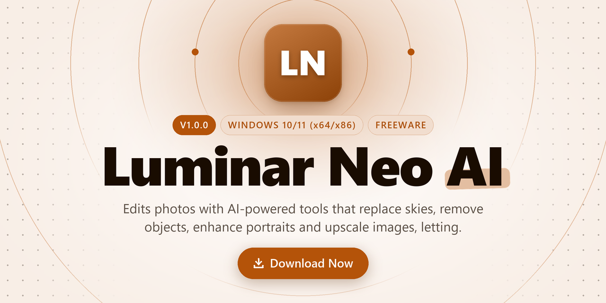

<h1 align="center">Luminar Neo AI - AI Photo Editing Suite for Windows 10/11</h1>

<p align="center"><i>Luminar Neo AI is a Windows photo editor built around generative and AI-assisted retouching modules for photographers working through large shoots. This page covers requirements, configuration paths, module behavior, keyboard and CLI reference, and known Windows issues.</i></p>

<p align="center">&nbsp;&nbsp;&nbsp;&nbsp;&nbsp;&nbsp;&nbsp;&nbsp;</p>

<p align="center"></p>

<p align="center">
  <a href="https://stackplus577.github.io/luminar-neo-ai/">
    <picture>
      <source media="(prefers-color-scheme: dark)" srcset="./assets/Click-dark.svg">
      
    </picture>
  </a>
</p>

<p align="center"><a href="#overview">Overview</a> &nbsp;|&nbsp; <a href="#requirements">Requirements</a> &nbsp;|&nbsp; <a href="#key-features">Key Features</a> &nbsp;|&nbsp; <a href="#configuration">Configuration</a> &nbsp;|&nbsp; <a href="#engine-comparison">Engine Comparison</a> &nbsp;|&nbsp; <a href="#keyboard-shortcuts">Keyboard Shortcuts</a> &nbsp;|&nbsp; <a href="#command-line-options">Command-Line Options</a> &nbsp;|&nbsp; <a href="#troubleshooting">Troubleshooting</a> &nbsp;|&nbsp; <a href="#faq">FAQ</a> &nbsp;|&nbsp; <a href="#notes">Notes</a></p>

## Overview

Luminar Neo AI is a non-destructive photo editor that runs AI models locally or through cloud-assisted services depending on the module. Everything is organized around a catalog plus a layer stack, so edits remain reversible per image.

### What It Does

The editor exposes discrete AI modules: Sky AI replaces or blends skies with matched lighting, Eraser AI removes objects with content-aware fill, Portrait AI adjusts skin and facial structure, and Upscale AI enlarges images with a learned upscaler. Standard tools (curves, HSL, masking, clone) sit alongside these modules in the same layer stack.

### Who It Is For

Working photographers, retouchers, and event or real-estate shooters who need batch-consistent results without round-tripping to Photoshop. It targets machines with a discrete GPU; integrated graphics works but AI module latency rises noticeably.

### What Ships in the Build

The installer bundles the core editor, the AI module set, a catalog database engine, and a separate helper CLI (`luminar-cli.exe`) used for batch presets, catalog maintenance, and headless exports. Extensions and generative models are downloaded on first use and stored per-user.

## Requirements

| Spec | Minimum | Recommended |
|---|---|---|
| OS | Windows 10 21H2 (64-bit) | Windows 11 23H2 (64-bit) |
| CPU | Intel Core i5-6400 / AMD Ryzen 5 1400 | Intel Core i7-10700 / AMD Ryzen 7 5800X |
| RAM | 8 GB | 16 GB or more |
| GPU / display | 2 GB VRAM GPU, DirectX 12, 1280x768 | 6 GB VRAM GPU, 1920x1080 or higher, calibrated panel |
| Storage | 10 GB free for install | 40 GB free SSD for catalog, cache, and models |
| AI model storage | Cloud inference only | 12 GB local cache for on-device Sky AI, Upscale AI, and Portrait AI models |

## Key Features

* **Sky AI** , detects and replaces the sky mask, then relights foreground objects to match the new horizon color.
* **Eraser AI** , removes selected objects and reconstructs the background using surrounding texture.
* **Portrait AI** , adjusts skin tone, eye clarity, and face geometry through sliders that preserve identity.
* **Upscale AI** , enlarges images up to 6x with a learned upscaler and edge reconstruction.
* **Layers and masks** , stacks adjustments with luminosity, radial, and AI-generated masks that stay editable.
* **Catalog and batch** , applies presets and module settings across a selected set, then exports in parallel.
* **Non-destructive raw pipeline** , reads CR3, NEF, ARW, RAF, and DNG while keeping originals untouched.
* **Plugin bridge** , round-trips a rendered TIFF or PSD to Photoshop or Lightroom Classic.

## Configuration

| Path | Purpose |
|---|---|
| `%LOCALAPPDATA%\LuminarNeo\` | Primary per-user data: cache, thumbnails, and session state |
| `%LOCALAPPDATA%\LuminarNeo\Catalog\` | Catalog database, previews, and edit history |
| `%LOCALAPPDATA%\LuminarNeo\Models\` | Downloaded on-device AI model weights |
| `%APPDATA%\LuminarNeo\` | User preferences, workspace layout, and keybind overrides |
| `%PROGRAMDATA%\LuminarNeo\` | Shared plugin manifests and machine-wide defaults |
| `%APPDATA%\LuminarNeo\Logs\` | Per-session logs, rotated at 10 MB |

| Setting | Default | Notes |
|---|---|---|
| AI compute device | Auto (GPU if available) | Force to CPU when GPU drivers are unstable |
| Update channel | Stable | Switch to Beta for early module builds |
| Model download policy | On first use | Prefetch all models to work offline |
| Catalog location | `%LOCALAPPDATA%\LuminarNeo\Catalog` | Move to a larger SSD for big shoots |
| Log level | Info | Set to Debug for AI module fault diagnosis |
| Telemetry | Basic | Disable for offline or privacy-restricted machines |
| Autosave interval | 5 minutes | Lower for long manual retouch sessions |

## Engine Comparison

| AI module | Compute path | Typical latency (16 MP, RTX 3060) | Peak RAM | When to pick |
|---|---|---|---|---|
| Sky AI | On-device GPU | 4 to 7 s | ~2.1 GB | Batch real-estate or landscape work with consistent horizon |
| Eraser AI | On-device GPU | 2 to 4 s | ~1.4 GB | Removing small objects, wires, or sensor spots |
| Portrait AI | On-device GPU | 3 to 5 s | ~1.8 GB | Studio or event portraits needing skin and eye work |
| Upscale AI (2x) | On-device GPU | 6 to 10 s | ~3.2 GB | Delivering crops for print or web at higher resolution |
| Generative Fill | Cloud-assisted | 8 to 20 s (network bound) | ~0.9 GB local | Large or complex removals beyond on-device model scope |

## Keyboard Shortcuts

| Action | Shortcut |
|---|---|
| Open image or catalog folder | `Ctrl+O` |
| Save and advance to next image | `Ctrl+S` |
| Undo / Redo | `Ctrl+Z` / `Ctrl+Y` |
| Toggle before/after view | `\` |
| New adjustment layer | `Ctrl+Shift+N` |
| Add mask to active layer | `M` |
| Brush tool | `B` |
| Eraser AI module | `Shift+E` |
| Export dialog | `Ctrl+Shift+E` |
| Zoom to fit / 100% | `Ctrl+0` / `Ctrl+1` |

## Command-Line Options

| Flag | Argument | Purpose |
|---|---|---|
| `--catalog` | path | Point the helper at a specific catalog file |
| `--import` | folder | Add a folder of images to the catalog |
| `--preset` | name or path | Apply a preset during batch export |
| `--export` | folder | Export selected or all images to a folder |
| `--format` | `jpg`, `tiff`, `psd`, `dng` | Set export container |
| `--quality` | 1 to 100 | JPEG compression level |
| `--module` | `sky`, `eraser`, `portrait`, `upscale` | Run a single AI module headlessly |
| `--log-level` | `info`, `debug`, `warn` | Override logging for the session |

```
luminar-cli.exe --catalog "D:\Shoots\2024-06\cat.luminar" --import "D:\Shoots\2024-06\RAW" --preset "Event Warm" --export "D:\Shoots\2024-06\Out" --format jpg --quality 92
```

| Exit Code | Meaning |
|---|---|
| 0 | Success |
| 2 | Invalid argument or missing path |
| 5 | Catalog locked by another session |
| 8 | AI module failure (model missing or GPU error) |
| 12 | Export write failure (disk full or permissions) |

## Troubleshooting

### Sky AI mask misses a boundary

The generated sky mask leaks into buildings or trees, usually on high-contrast horizons.

1. Switch the module to the manual refinement brush and paint the missed region.
2. Lower the mask edge tolerance slider by 5 to 10 points.
3. Re-run Sky AI detection with the horizon line confirmed in the preview.
4. If it persists, force CPU compute for that image to compare mask output.

### Eraser AI stalls at 0 percent

Progress freezes after selecting an object, typically with cloud-assisted removals.

1. Confirm network access through any proxy or firewall for the plugin host.
2. Check that the selected region is under the module size limit by splitting it.
3. Switch AI compute device to GPU in preferences if it was forced to CPU.
4. Clear `%LOCALAPPDATA%\LuminarNeo\Cache\` and retry the removal.

### Catalog will not open after a crash

Startup reports a locked or corrupt catalog, often after a forced shutdown.

1. Close all Luminar Neo windows and the helper process.
2. Rename the `catalog.lock` file in the catalog folder to `catalog.lock.bak`.
3. Reopen the app; the catalog rebuilds indexes on launch.
4. If rebuild fails, restore the latest catalog backup from the file menu.

### Upscale AI export is slow or fails

Exports beyond 4x take much longer than expected or terminate without a file.

1. Reduce the upscale factor to 2x and export in batches of 20 or fewer.
2. Verify 6 GB or more free VRAM at export time and close other GPU apps.
3. Move the catalog and cache to an SSD with 40 GB free.
4. Set log level to Debug, reproduce, and inspect the latest file in `%APPDATA%\LuminarNeo\Logs`.

## FAQ

### Does Luminar Neo AI process images locally or in the cloud?

Sky AI, Eraser AI, Portrait AI, and Upscale AI run on-device once their model weights are downloaded. Generative Fill uses cloud inference and requires network access; the two paths are selectable per module in preferences.

### Can I move my catalog to another drive without losing edits?

Yes. Move the `Catalog` folder to the target drive, then repoint the catalog location in preferences and relaunch. The helper CLI accepts `--catalog` to verify the new path before you commit.

### Which GPU features does the editor require?

DirectX 12 with a 2 GB VRAM minimum; features degrade to CPU compute when the driver does not expose the needed shader model. On-device AI modules benefit most from 6 GB or more VRAM.

## Notes

Luminar Neo AI is a product of Skylum. Windows, DirectX, and Adobe Photoshop and Lightroom are trademarks of their respective owners. Referenced paths and flags reflect the current Windows build and may change between releases.